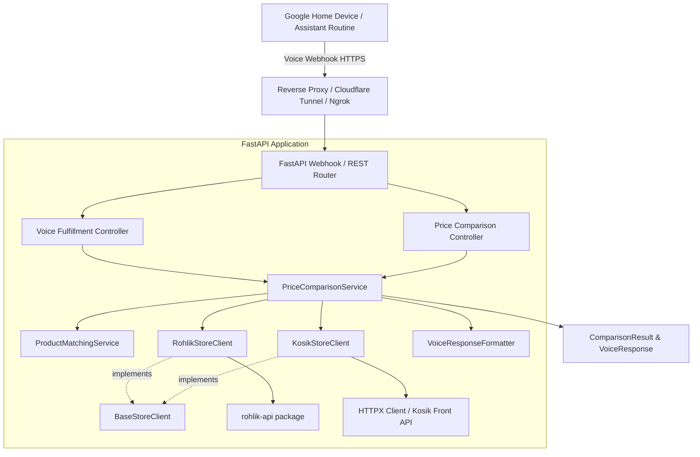

# Implementation Plan: Grocery Price Comparator (Košík vs. Rohlík) with Google Home Integration

## 1. Executive Summary & Objective

The goal is to build a modern, production-grade Python backend using **FastAPI** that compares grocery prices between **Rohlík.cz** and **Košík.cz** in real-time, helping the user determine which store offers the best price before placing an order.

The service is reachable as an API from **Google Home** devices via **IFTTT** for voice queries (e.g., *"Hey Google, check price of butter"* or *"Hey Google, is Košík or Rohlík cheaper for milk?"*), understands queries spoken in **English**, queries the Czech store catalogs using bilingual term mapping (e.g. "milk" -> "mléko", "butter" -> "máslo"), returns clear speech-ready responses in English, and provides structured REST endpoints for programmatic access and basket comparisons.

### Core Constraints & Principles
* **Build only what is necessary**: Leverage existing open-source libraries (e.g. `rohlik-api`) rather than reinventing custom SDKs.
* **100% Pydantic v2**: All domain entities, requests, responses, and configurations must be strictly typed Pydantic models.
* **Strict Object-Oriented Programming (OOP)**: Clear separation of concerns with abstract base classes, repository/client patterns, and dependency injection.
* **Bilingual Query Intelligence**: Automatic English-to-Czech translation and synonym expansion for grocery terms before querying store search engines.
* **Google Home via IFTTT**: Dedicated webhook contract optimized for IFTTT Google Assistant service ("Say a phrase with a text ingredient").
* **GitHub Repository Standards**: `.gitignore`, `.env.example`, strict secrets prevention, comprehensive `README.md`, `CHANGELOG.md`, and unit tests.
* **Dockerized & Production Ready**: Containerized deployment with Docker & Docker Compose, environment configuration, and strict typing (`mypy`).

---

## 2. Store Integration Strategy

### 2.1 Rohlík.cz Integration
* **Existing Solution**: [`rohlik-api`](https://pypi.org/project/rohlik-api/) (developed by George Dvejsada).
  * Asynchronous, typed Python client wrapping Rohlík's backend.
  * Native support for `client.products.search(query)` and product details (price, package size, unit price, stock status).
  * Supports authenticated (credentials from env) and public anonymous browsing mode.

### 2.2 Košík.cz Integration
* **Analysis**: Košík.cz does not publish an official PyPI package, but provides:
  1. An official **Model Context Protocol (MCP)** endpoint (`https://mcp.kosik.cz/mcp/`) designed for AI/agentic tool querying.
  2. Public front-end JSON search endpoints used by their web app (`https://www.kosik.cz/api/front/page/search?slug={query}`).
* **Strategy**:
  * Implement `KosikStoreClient` adhering to the common `BaseStoreClient` interface.
  * Utilize an `httpx` async client to query Košík's search endpoint with polite headers and session handling.
  * Parse and normalize the Košík JSON product structure directly into the shared Pydantic `StoreProduct` model.

---

## 3. System Architecture & Class Hierarchy



### 3.1 OOP Design & Abstractions

* `BaseStoreClient(ABC)`:
  * Abstract methods:
    * `search_products(query: str, limit: int = 5) -> Sequence[StoreProduct]`
    * `get_product_by_id(product_id: str) -> Optional[StoreProduct]`
    * `check_health() -> bool`
* `RohlikStoreClient(BaseStoreClient)`:
  * Wraps `rohlik-api`.
  * Transforms native Rohlík data models into domain `StoreProduct` models.
* `KosikStoreClient(BaseStoreClient)`:
  * Manages HTTP session and headers for Košík.
  * Transforms Košík JSON search items into domain `StoreProduct` models.
* `ProductMatchingService`:
  * Computes similarity between search results, handles normalized unit pricing (e.g. price per 100g, 1L, 1kg), and pairs matching items between both supermarkets.
* `PriceComparisonService`:
  * High-level orchestrator. Queries both clients in parallel via `asyncio.gather`, delegates matching to `ProductMatchingService`, and computes the winning store, price difference, and percentage savings.
* `VoiceResponseFormatter`:
  * Generates concise, natural speech strings in Czech and English (e.g. *"Rohlík is cheaper for whole milk at 22.90 CZK, saving you 4 CZK compared to Košík"*).

---

## 4. Google Home Integration Architecture (via IFTTT)

The primary voice integration uses **IFTTT** with the **Google Assistant** service:

1. **Trigger in IFTTT**:
   * Service: *Google Assistant*
   * Trigger: *"Say a phrase with a text ingredient"*
   * What do you want to say?:
     * *"Check price of $"*
     * *"Compare grocery price of $"*
     * *"Who is cheaper for $"*
2. **Action in IFTTT**:
   * Service: *Webhooks*
   * Action: *"Make a web request"*
   * URL: `https://<your-public-domain>/api/v1/voice/ifttt`
   * Method: `POST`
   * Content-Type: `application/json`
   * Body:
     ```json
     {
       "ingredient": "{{TextField}}",
       "device_id": "google_home"
     }
     ```
3. **Response Handling**:
   * The FastAPI endpoint receives the text ingredient (e.g., *"butter"* or *"plnotučné mléko"*).
   * It translates and normalizes the query via the `BilingualQueryService`.
   * Queries both stores concurrently, computes price comparison and winner.
   * Responds with an IFTTT-friendly payload containing an English spoken summary:
     ```json
     {
       "message": "Rohlik is cheaper for butter at 52.90 CZK compared to 59.90 CZK on Kosik, saving you 7.00 CZK.",
       "fulfillmentText": "Rohlik is cheaper for butter at 52.90 CZK compared to 59.90 CZK on Kosik, saving you 7.00 CZK.",
       "success": true
     }
     ```
   * Can be spoken directly back through Google Home notifications or read aloud by compatible assistant actions.

---

## 5. Bilingual Query Intelligence

Because the user will speak in English (e.g. *"eggs"*, *"whole milk"*, *"ground coffee"*, *"beer"*), but Czech grocery websites index primarily Czech titles (*"vejce"*, *"plnotučné mléko"*, *"mletá káva"*, *"pivo"*), a dedicated `BilingualQueryService` is integrated:
* Maintains a comprehensive dictionary of grocery terms, categories, cuts, and package descriptors (EN $\leftrightarrow$ CS).
* If the incoming query is English, it extracts the key product intent and generates both the primary Czech search term and search synonyms.
* If the incoming query is already Czech, it preserves and refines the Czech search term while maintaining English response generation.
* Retains recognizable product brands (e.g. Pilsner Urquell, Madeta, Barilla, Lindt) across both languages.

---

## 6. Domain Models (100% Pydantic v2)

All models will reside in `app/models/`:

### 5.1 Enums & Basic Types (`enums.py`)
```python
from enum import Enum

class StoreType(str, Enum):
    ROHLIK = "rohlik"
    KOSIK = "kosik"

class UnitType(str, Enum):
    KILOGRAM = "kg"
    GRAM = "g"
    LITER = "l"
    MILLILITER = "ml"
    PIECE = "pcs"
    UNKNOWN = "unknown"

class PriceAdvantage(str, Enum):
    ROHLIK_CHEAPER = "rohlik_cheaper"
    KOSIK_CHEAPER = "kosik_cheaper"
    TIED = "tied"
    UNAVAILABLE = "unavailable"
```

### 5.2 Product Models (`product.py`)
```python
from pydantic import BaseModel, Field, HttpUrl
from typing import Optional
from decimal import Decimal
from app.models.enums import StoreType, UnitType

class StoreProduct(BaseModel):
    store: StoreType = Field(..., description="Store where product is listed")
    product_id: str = Field(..., description="Unique product ID in the store")
    name: str = Field(..., description="Full display name of the product")
    brand: Optional[str] = Field(None, description="Brand name if available")
    price: Decimal = Field(..., ge=0, description="Current price in CZK")
    original_price: Optional[Decimal] = Field(None, description="Original price before discount")
    is_on_sale: bool = Field(default=False, description="Whether product has a promotional price")
    unit_type: UnitType = Field(default=UnitType.UNKNOWN, description="Base measurement unit")
    unit_price: Optional[Decimal] = Field(None, description="Price per base unit (e.g. per 1kg/1L)")
    package_amount: Optional[Decimal] = Field(None, description="Weight/volume quantity")
    in_stock: bool = Field(default=True, description="Stock availability")
    url: Optional[str] = Field(None, description="Direct product link")
    image_url: Optional[str] = Field(None, description="Product thumbnail URL")
```

### 5.3 Comparison Models (`comparison.py`)
```python
from pydantic import BaseModel, Field
from typing import Optional, List
from decimal import Decimal
from app.models.enums import PriceAdvantage, StoreType
from app.models.product import StoreProduct

class MatchedProductPair(BaseModel):
    query: str = Field(..., description="Original search term")
    rohlik_product: Optional[StoreProduct] = Field(None, description="Matched Rohlik item")
    kosik_product: Optional[StoreProduct] = Field(None, description="Matched Kosik item")
    advantage: PriceAdvantage = Field(..., description="Which store is cheaper for this item")
    cheaper_store: Optional[StoreType] = Field(None)
    price_difference: Decimal = Field(default=Decimal("0.00"), description="Absolute difference in CZK")
    percentage_savings: Decimal = Field(default=Decimal("0.0"), description="Percentage saved by choosing cheaper")

class ComparisonResponse(BaseModel):
    query: str
    summary_cz: str = Field(..., description="Voice-ready summary in Czech")
    summary_en: str = Field(..., description="Voice-ready summary in English")
    advantage: PriceAdvantage
    cheapest_store: Optional[StoreType]
    matched_items: List[MatchedProductPair]
```

### 6.4 Voice Webhook Request & Response Models (`voice.py`)
```python
from pydantic import BaseModel, Field
from typing import Optional, Dict, Any

class IFTTTWebhookRequest(BaseModel):
    ingredient: str = Field(..., description="Item search phrase extracted by IFTTT Google Assistant routine")
    device_id: Optional[str] = Field(default="google_home", description="Device identifier")

class GoogleHomeVoiceResponse(BaseModel):
    message: str = Field(..., description="Primary response message in English")
    fulfillmentText: str = Field(..., description="Spoken text for assistant voice playback")
    success: bool = Field(default=True, description="Query execution status")
```

---

## 7. Pre-Configured Staples ("Apples-to-Apples" Catalog)

While dynamic keyword search works for ad-hoc voice queries (e.g. *"check price of bananas"*), comparing grocery items across stores often suffers from ambiguous matches (e.g. organic Bio milk vs. discount brand milk).

To ensure high-accuracy comparison, the application will provide a **Staple Products Mapping Configuration** (`config/staples.yaml` or `.json`):
* Allows pre-defining canonical staples with exact store product IDs or strict search keywords:
  * `whole_milk_1l` (Madeta Plnotučné 1L)
  * `butter_250g` (Jihočeské máslo 250g)
  * `eggs_m_10` (Vejce M 10 ks)
  * `pilsner_urquell_05l` (Pilsner Urquell 0.5l láhev/plech)
  * `bananas_1kg` (Banány 1kg)
* When a user queries a staple, the system can fetch exact product matches without guessing.

---

## 8. API & Web Endpoints Specification

| Method | Endpoint | Description |
| :--- | :--- | :--- |
| `GET` | `/` | Web UI: Interactive search, side-by-side comparison & voice test preview |
| `GET` | `/health` | Service and store clients health check |
| `POST` | `/api/v1/voice/ifttt` | Webhook endpoint for IFTTT Google Assistant text ingredient |
| `GET` | `/api/v1/voice/query?q={item}&lang={en\|cs}` | Direct GET voice query (for easy testing & simple webhooks) |
| `GET` | `/api/v1/compare?q={item}&lang={en\|cs}` | Full JSON REST comparison for a single item or keyword |
| `POST` | `/api/v1/compare/basket` | Multi-item basket price comparison |
| `GET` | `/api/v1/staples` | List configured standard staple items |

---

## 9. Project Structure

```
grocery_planner/
├── .env.example
├── .gitignore
├── Dockerfile
├── docker-compose.yml
├── pyproject.toml
├── README.md
├── CHANGELOG.md
├── LICENSE
├── IMPLEMENTATION_PLAN.md
├── config/
│   └── staples.yaml                # Pre-mapped staple products
├── static/
│   ├── index.html                  # Responsive modern web UI
│   ├── app.js                      # Search & comparison controller
│   └── style.css                   # Modern styling
├── app/
│   ├── __init__.py
│   ├── main.py                     # FastAPI application factory & lifespan
│   ├── core/
│   │   ├── __init__.py
│   │   ├── config.py               # Pydantic BaseSettings (env vars)
│   │   └── exceptions.py           # Custom typed domain exceptions
│   ├── models/
│   │   ├── __init__.py
│   │   ├── enums.py                # StoreType, UnitType, PriceAdvantage
│   │   ├── product.py              # StoreProduct, PackageInfo
│   │   ├── comparison.py           # MatchedProductPair, ComparisonResponse
│   │   └── voice.py                # IFTTTWebhookRequest, GoogleHomeVoiceResponse
│   ├── clients/
│   │   ├── __init__.py
│   │   ├── base.py                 # BaseStoreClient (abstract class)
│   │   ├── rohlik.py               # RohlikStoreClient (using rohlik-api)
│   │   └── kosik.py                # KosikStoreClient (using HTTPX)
│   ├── services/
│   │   ├── __init__.py
│   │   ├── bilingual.py            # BilingualQueryService (EN <-> CS mapping)
│   │   ├── matcher.py              # ProductMatchingService
│   │   ├── comparator.py           # PriceComparisonService
│   │   └── voice_formatter.py      # VoiceResponseFormatter (English voice formatting)
│   └── api/
│       ├── __init__.py
│       ├── deps.py                 # FastAPI dependency injection providers
│       ├── v1/
│       │   ├── __init__.py
│       │   ├── router.py           # API v1 central router
│       │   ├── compare.py          # /compare endpoints
│       │   ├── voice.py            # /voice webhooks for IFTTT & Google Home
│       │   └── staples.py          # /staples endpoints
└── tests/
    ├── __init__.py
    ├── conftest.py
    ├── test_bilingual.py
    ├── test_comparator.py
    ├── test_matcher.py
    ├── test_rohlik_client.py
    ├── test_kosik_client.py
    └── test_voice_api.py
```

---

## 10. Docker & Environment Configuration

### 9.1 Environment Variables (`.env`)
```env
# Application Settings
ENVIRONMENT=production
DEBUG=false
APP_HOST=0.0.0.0
APP_PORT=8000
DEFAULT_LANGUAGE=cs

# Optional Rohlik Account (for personalized prices/club sales, otherwise anonymous)
ROHLIK_USERNAME=
ROHLIK_PASSWORD=

# Optional Kosik Account (otherwise public search API)
KOSIK_USER_TOKEN=

# Cache & Request Configuration
REQUEST_TIMEOUT_SECONDS=10
CACHE_TTL_SECONDS=300
```

### 10.2 Containerization
* Multi-stage build with `python:3.12-slim`.
* Non-root user execution (`appuser`).
* Healthcheck directive on `GET /health`.

---

## 11. Step-by-Step Implementation Roadmap

1. **Step 1: Project Setup & Dependencies**
   * Initialize dependencies: `fastapi`, `uvicorn[standard]`, `pydantic`, `pydantic-settings`, `rohlik-api`, `httpx`, `pyyaml`, `pytest`, `pytest-asyncio`, `mypy`.
   * Configure `pyproject.toml` with strict mypy settings.

2. **Step 2: Core Domain Models (100% Pydantic)**
   * Implement `enums.py`, `product.py`, `comparison.py`, `voice.py`.
   * Implement `core/config.py` with `pydantic-settings`.

3. **Step 3: Supermarket Clients (OOP)**
   * Define `BaseStoreClient` interface.
   * Implement `RohlikStoreClient` wrapping `rohlik-api`.
   * Implement `KosikStoreClient` with `httpx` async requests to Košík search.
   * Add unit tests with mock payloads for both clients.

4. **Step 4: Bilingual Engine & Comparison Logic**
   * Implement `BilingualQueryService` (EN <-> CS vocabulary, synonym expansion).
   * Implement `ProductMatchingService` (fuzzy name matching, unit normalization).
   * Implement `PriceComparisonService` (concurrent fetching via `asyncio.gather`, difference and winner calculation).
   * Implement `VoiceResponseFormatter` with clear English voice prompts.

5. **Step 5: API & IFTTT Google Home Webhook Endpoints**
   * Build `/api/v1/voice/ifttt`, `/api/v1/compare`, and `/api/v1/staples`.
   * Test webhook payload compatibility.

6. **Step 6: Dockerization, Git & GitHub Readiness**
   * Create `Dockerfile` and `docker-compose.yml`.
   * Set up `.gitignore`, `.env.example`, `CHANGELOG.md`, `LICENSE`, and `README.md` with IFTTT setup guide.
   * Initialize git repository.

---

## 12. Aligned Decisions & Confirmation

1. **Google Home Setup**:
   * **Confirmed**: Connected via **IFTTT** Google Assistant trigger (*"Say a phrase with a text ingredient"* $\rightarrow$ Webhook $\rightarrow$ Spoken response).
2. **Authentication & Security**:
   * **Confirmed**: Sensitive credentials stored in `.env`, strictly excluded from version control via `.gitignore`. An `.env.example` template is provided.
   * Repository initialized with `CHANGELOG.md`, `README.md`, `LICENSE`, and GitHub security conventions.
3. **Language & Bilingual Intelligence**:
   * **Confirmed**: Spoken queries will be in **English**, and spoken voice responses will be formatted in **English**.
   * The backend automatically translates and maps grocery terms into **Czech** (with synonym expansion) to query Rohlík and Košík accurately, since both supermarkets index products in Czech.

